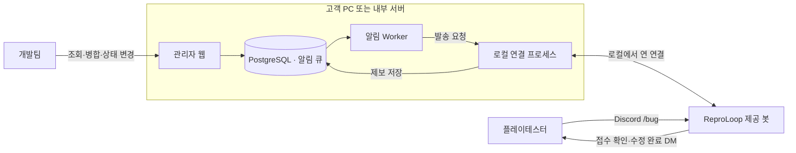

# ReproLoop

**Discord에서 받은 게임 버그 제보를 재현·수정하고, 어떤 빌드에서 고쳤는지 제보자에게 알려주는 플레이테스트 도구입니다.**

## Service Overview

ReproLoop는 Discord로 테스트를 운영하는 소규모 게임 팀을 위한 도구입니다. 플레이테스터가 문제가 발생한 빌드와 재현 절차를 제출하면, 개발팀은 제보를 한곳에서 모아 조사하고 같은 문제를 묶어 처리할 수 있습니다. 팀이 수정한 빌드를 기록하면 봇이 해당 문제를 제보한 플레이테스터에게 Discord DM을 보냅니다.

배포 목표는 **ReproLoop가 Discord 봇을 운영하고, 고객이 관리자 웹·PostgreSQL·Worker를 자기 PC나 내부 서버에 설치하는 방식**입니다. 제보 본문, 프로젝트, 빌드, 처리 이력은 고객의 PostgreSQL에 저장됩니다. Discord에서 폼을 제출하거나 DM을 보낼 때 필요한 정보는 Discord와 ReproLoop 봇을 거칩니다. 봇은 구축되어 있으며, 제공 봇과 고객 로컬 설치본을 연결하는 기능과 설치 패키지는 출시 준비 항목입니다.

## 활용 상황과 기대효과

| 상황 | 사용 방법 | 기대효과 |
| --- | --- | --- |
| 비공개 테스트에서 여러 사람이 같은 멈춤 현상을 제보함 | 테스터가 `/bug`로 증상을 제출하고, 담당자가 제보를 비교해 한 건을 대표로 지정합니다. | 조사와 수정 이력을 한 곳에서 관리하고, 같은 문제를 여러 번 조사하는 일을 줄일 수 있습니다. |
| 한 서버에서 여러 프로젝트와 테스트 빌드를 운영함 | 제보할 때 프로젝트와 문제 발생 빌드를 선택하고, 개발팀은 제보함에서 필요한 항목을 검색합니다. | 문제가 발생한 빌드를 파악하고 재현 환경을 다시 묻는 시간을 줄일 수 있습니다. |
| 패치 후 원래 제보자에게 재검증을 부탁하고 싶음 | 대표 제보를 수정 완료로 바꾸고 수정 빌드를 선택합니다. 대표·중복 제보 작성자가 빌드 정보가 포함된 DM을 받습니다. | 제보자가 어떤 버전에서 다시 확인할지 알 수 있고, 담당자가 개별 연락할 일이 줄어듭니다. |
| 팀 정책상 제보 기록을 내부 환경에 보관해야 함 | 팀이 관리하는 PC나 내부 서버에 설치해 PostgreSQL 데이터를 보관하고 백업합니다. | 보관 기간과 백업·복구 방식을 팀이 관리할 수 있습니다. |

도입 효과는 제보 접수부터 재현 확인까지 걸린 시간, 대표 제보에 통합한 건수, 수정 알림의 발송 결과를 기록해 확인할 수 있습니다.

## Tech Stack

| 영역 | 기술 |
| --- | --- |
| 관리자 웹·랜딩 | Next.js, React, TypeScript, Tailwind CSS |
| 인증·제보 접수 | NextAuth.js, Discord OAuth, Discord Interactions |
| 데이터베이스 | PostgreSQL, Drizzle ORM |
| 알림 Worker | Node.js, pg-boss, Discord Bot API |
| 개발 환경·CI | pnpm Workspaces, Vitest, GitHub Actions |

## Key Features

- **Discord 버그 접수** — 프로젝트와 빌드를 선택하고 실제 현상, 기대 결과, 재현 방법을 입력합니다. 같은 제출 요청이 재전송돼도 제보는 한 건만 저장됩니다.
- **관리자 제보함** — Discord 계정으로 로그인해 접근 권한이 있는 프로젝트의 제보를 검색·필터링하고 상세 내용과 처리 이력을 확인합니다.
- **중복 병합과 상태 변경** — 중복 제보를 대표 제보에 연결하고 조사 시작, 재현 완료, 수정 완료를 기록합니다.
- **수정 완료 알림** — 수정 빌드를 선택하면 대표·중복 제보의 고유 수신자를 계산하고 Discord DM 발송을 예약합니다.

## 제보 처리 절차

1. **테스터가 제보합니다.** Discord에서 `/bug`를 실행하고 프로젝트와 문제 발생 빌드를 선택합니다. 입력 폼에 실제 현상, 기대 결과, 재현 방법, 플랫폼, 발생 빈도를 적어 제출합니다.
2. **시스템이 접수합니다.** 프로젝트와 빌드가 해당 Discord 서버에 연결되어 있는지 확인하고 제보와 접수 이력을 저장합니다. 저장 후 제출자에게만 `BUG-번호`를 담은 접수 결과를 보여줍니다. 같은 제출 요청이 다시 처리되면 기존 제보를 사용합니다.
3. **개발팀이 조사합니다.** 제보함에서 목록·상세·이력을 확인하고 조사 시작 또는 재현 완료를 기록합니다. 동일 증상은 `owner` 또는 `admin`이 대표 제보에 병합합니다. `member`는 조사 시작과 재현 완료를 기록할 수 있습니다.
4. **담당자가 수정 버전을 기록합니다.** 실제 수정 사항이 포함된 빌드를 선택하고, 재현 완료된 대표 제보를 `owner` 또는 `admin`이 수정 완료로 변경합니다. 시스템은 상태 변경 이력과 발송할 알림을 저장합니다.
5. **봇이 제보자에게 알립니다.** 알림 Worker가 발송을 요청하고, 봇은 제보 번호와 수정 빌드를 Discord DM으로 안내합니다. 같은 사람이 대표 제보와 중복 제보를 모두 작성한 경우에도 수신자 목록에는 한 번만 들어갑니다.

## System Architecture

출시 목표 구조에서 고객 로컬 설치본이 봇 서비스에 연결합니다. 관리자 화면과 PostgreSQL은 기본 설정에서 설치한 기기 안에서 접근합니다.



저장소에서 `apps/web`은 관리자 화면과 현재 Discord 요청 처리 코드, `apps/worker`는 알림 처리, `apps/marketing`은 제품 소개와 브라우저 데모를 담습니다. `packages/`에는 DB 접근, 업무 규칙, 공통 API 계약이 있습니다.

## Getting Started

### 지금 제품 흐름 살펴보기

소스 체크아웃이 있다면 Node.js 22.13 이상과 pnpm 11을 준비하고 저장소 루트에서 실행하세요. 실행 후 [localhost:3001](http://localhost:3001)에서 **3분 데모 체험**을 선택하면 샘플 제보의 접수·병합·수정 완료 흐름을 살펴볼 수 있습니다. 체험은 브라우저 안에서 동작합니다.

```bash
pnpm install --frozen-lockfile
pnpm --filter @reproloop/marketing dev --hostname 127.0.0.1 --port 3001
```

### 고객 설치 및 첫 제보 · 출시 후 절차

> [!IMPORTANT]
> 아래는 로컬 설치 패키지와 봇 연결 기능을 배포한 후의 절차입니다. 진행 중인 항목은 [최종 구현 계획](./docs/최종%20구현%20계획.md)에서 확인할 수 있습니다.

**준비물** — 플레이테스트용 Discord 서버, 해당 서버의 **서버 관리** 권한, Docker와 Docker Compose가 설치된 PC 또는 내부 서버, 인터넷 연결이 필요합니다. `docker compose version`이 버전을 출력하면 Compose를 사용할 수 있습니다. 실제 Discord 제보와 DM을 처리하는 동안 로컬 서비스가 실행 중이어야 합니다. [Docker Compose 설치](https://docs.docker.com/compose/install/) · [Discord 서버 설치 권한](https://docs.discord.com/developers/quick-start/getting-started#choosing-installation-contexts)

1. **로컬 서비스 실행.** 배포 시 제공되는 버전별 설치 패키지를 내려받아 압축을 풀고, `compose.yml`이 있는 폴더에서 다음 명령을 실행합니다. 웹·DB·Worker의 상태는 `docker compose ps`에서 확인합니다.

   ```bash
   docker compose up -d
   docker compose ps
   ```

2. **관리자 계정 만들기.** 설치한 기기에서 [localhost:3000](http://localhost:3000)을 열고 초기 설정에 따라 관리자 계정과 팀을 만듭니다. PostgreSQL 데이터는 설치본의 로컬 볼륨에 보관됩니다.
3. **Discord 봇 추가 및 연결.** 초기 설정 화면에서 제공하는 봇 초대 링크를 열고 플레이테스트 서버에 추가합니다. 해당 서버에서 `/reproloop connect`를 실행해 본인에게 표시되는 일회용 코드를 복사하고, 관리자 웹의 **Discord 연결**에 입력합니다. 화면에서 Discord 서버 이름과 **연결됨** 상태를 확인합니다.
4. **프로젝트와 빌드 등록.** 관리자 웹에서 첫 프로젝트를 만들고, 제보를 받을 활성 빌드(예: `0.8.14-beta`)를 등록합니다. 이후 테스트 버전이 바뀔 때마다 빌드를 추가합니다.
5. **첫 제보 확인.** Discord 테스트 채널에서 `/bug`를 실행하고 프로젝트·빌드를 선택해 샘플을 제출합니다. Discord에 나온 `BUG-번호`의 제보가 관리자 웹에도 표시되는지 확인합니다.
6. **수정 완료 확인.** 수정 빌드(예: `0.8.15-beta`)를 등록합니다. 테스트 제보를 재현 완료로 변경하고 수정 빌드를 선택해 수정 완료 처리한 뒤, 테스터 계정에서 Discord DM을 확인합니다.

### 설치본 종료와 문제 확인 · 출시 후 절차

- 서비스 종료에는 `docker compose down`을, 재시작에는 `docker compose up -d`를 사용합니다. 일반 종료 후에도 PostgreSQL 볼륨은 유지됩니다. [Docker Compose 종료 동작](https://docs.docker.com/reference/cli/docker/compose/down/)
- `/bug`가 보이지 않으면 봇을 추가한 서버와 해당 채널의 명령 사용 권한을 확인합니다. 프로젝트나 빌드가 비어 있으면 서버 연결 상태와 활성 빌드를 확인합니다.
- 로컬 연결이 끊겼다면 `docker compose ps`로 서비스 상태를 확인하고 관리자 웹의 **Discord 연결**을 확인합니다. DM이 도착하지 않으면 수신자의 DM 설정과 관리자 웹의 발송 결과를 확인합니다.

## 상세 문서 바로가기

- [최종 구현 계획](./docs/최종%20구현%20계획.md)
- [ReproLoop 문서 안내](./docs/ReproLoop%20문서%20안내.md)
- [현재 개발 환경의 Discord 설정과 검증](./docs/b-신정/guides/B-3단계_Discord_bug_설정과_검증_가이드.md)
