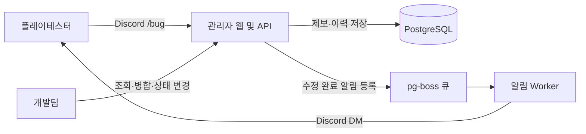

# ReproLoop

**Discord에서 받은 게임 버그 제보를 수정 완료 알림까지 이어주는 플레이테스트 도구입니다.**

## Service Overview

플레이테스터는 Discord의 `/bug` 명령으로 문제가 발생한 빌드와 재현 방법을 제보합니다. 개발팀은 관리자 웹에서 제보를 검토하고 중복 건을 대표 제보에 묶어 처리합니다. 수정이 완료되면 대표 제보와 중복 제보의 작성자에게 Discord DM으로 수정 빌드를 안내합니다.

## Tech Stack

| 영역 | 기술 |
| --- | --- |
| 관리자 웹·랜딩 | Next.js, React, TypeScript, Tailwind CSS |
| 인증·제보 접수 | NextAuth.js, Discord OAuth, Discord Interactions |
| 데이터베이스 | PostgreSQL, Drizzle ORM |
| 알림 Worker | Node.js, pg-boss, Discord Bot API |
| 개발 환경·CI | pnpm Workspaces, Vitest, GitHub Actions |

## Key Features

- **Discord 버그 접수** — 프로젝트와 빌드를 선택하고 실제 현상, 기대 결과, 재현 방법을 입력합니다. 같은 제출 요청이 재전송돼도 제보는 한 건만 저장됩니다.
- **관리자 제보함** — Discord 계정으로 로그인해 접근 권한이 있는 프로젝트의 제보를 검색·필터링하고 상세 내용과 처리 이력을 확인합니다.
- **중복 병합과 상태 변경** — 중복 제보를 대표 제보에 연결하고 조사 시작, 재현 완료, 수정 완료를 기록합니다.
- **수정 완료 알림** — 수정 빌드를 선택하면 대표·중복 제보의 고유 수신자를 계산하고, Worker가 각 수신자에게 Discord DM을 보냅니다.

## System Architecture



`apps/web`은 관리자 화면과 Discord 요청을 처리하고, `apps/worker`는 알림을 전송합니다. `apps/marketing`은 제품 소개와 브라우저 데모를 제공합니다. `packages/`에는 DB 접근, 업무 규칙, 공통 API 계약을 둡니다.

## Getting Started

Node.js 22.13 이상과 pnpm 11이 필요합니다. [환경변수 예시](./.env.example)를 참고해 `apps/web/.env.local`에 개발용 DB와 Discord 설정을, `apps/worker/.env`에 같은 DB의 `DATABASE_URL`과 `DISCORD_BOT_TOKEN`을 설정합니다. DB 준비와 Discord 연결은 [Discord 설정 가이드](./docs/b-신정/guides/B-3단계_Discord_bug_설정과_검증_가이드.md)를 참고하세요.

```bash
pnpm install --frozen-lockfile
pnpm --filter @reproloop/web dev
```

관리자 웹은 [localhost:3000](http://localhost:3000)에서 열립니다. DM을 검증하려면 별도 터미널에서 `pnpm --filter @reproloop/worker dev`를 실행합니다.

## 상세 문서 바로가기

- [ReproLoop 문서 안내](./docs/ReproLoop%20문서%20안내.md)
- [Day 9·10 마무리 계획](./docs/shared/ReproLoop_Day9_Day10_최종_실행_계획.md)
