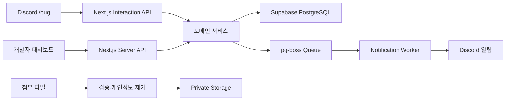

# ReproLoop 기술 스택 제안서

## 1. 결론

ReproLoop의 14일 MVP에는 **TypeScript 기반 모듈러 모놀리스** 구조를 권장한다.

> **Next.js + PostgreSQL(Supabase) + Drizzle + Auth.js + pg-boss + Railway**

2명이 짧은 기간 안에 제품 가설을 검증해야 하므로 프론트엔드와 백엔드를 별도 프로젝트로 분리하거나 Redis, 마이크로서비스 같은 추가 인프라를 도입하지 않는다.

---

## 2. 추천 기술 스택

| 영역 | 추천 기술 | 선택 이유 |
|---|---|---|
| 언어 | TypeScript | Discord, 웹, 워커를 한 언어로 개발할 수 있음 |
| 웹·API | Next.js App Router | 대시보드와 REST/Discord API를 한 프로젝트에서 처리 |
| UI | Tailwind CSS + shadcn/ui | 관리자 대시보드를 빠르게 제작 |
| Discord | HTTP Interactions + `discord-interactions` | Gateway 없이 Slash Command, Modal, 버튼 처리 |
| 인증 | Auth.js Discord Provider | 개발자 Discord 로그인 구현 |
| 데이터베이스 | Supabase PostgreSQL | 관리형 PostgreSQL과 Storage 제공 |
| DB 접근 | Drizzle ORM + Drizzle Kit | 타입 안전한 쿼리와 명시적인 마이그레이션 |
| 파일 저장 | Supabase Storage 비공개 버킷 | 만료되는 Signed URL 제공 |
| 백그라운드 작업 | pg-boss | Redis 없이 PostgreSQL로 알림 재시도와 파일 삭제 처리 |
| 배포 | Railway | 웹 서버와 장시간 실행되는 워커를 간단하게 배포 |
| 오류 추적 | Sentry | 프론트엔드, 서버, 워커 오류 통합 추적 |
| 제품 지표 | 자체 `product_events` 테이블 + PostHog 선택 적용 | 핵심 지표는 DB에 보존하고 분석 도구는 보조로 사용 |
| 테스트 | Vitest + Playwright | 도메인 로직과 핵심 사용자 흐름 검증 |

---

## 3. 권장 시스템 구조



### 저장소 구조

```text
reproloop/
├─ apps/
│  ├─ web/                 # Next.js 대시보드와 API
│  └─ worker/              # Discord 알림, 보관기간 만료 처리
├─ packages/
│  ├─ db/                  # Drizzle 스키마와 마이그레이션
│  ├─ domain/              # 상태 전이, 권한, 중복 처리
│  └─ shared/              # 공통 타입과 검증 스키마
└─ pnpm-workspace.yaml
```

별도의 모노레포 도구를 추가하지 않고 `pnpm workspace`만 사용해도 충분하다.

---

## 4. 주요 구현 결정

### 4.1 Discord Gateway를 사용하지 않는다

ReproLoop는 Discord 전체 메시지를 읽을 필요가 없으므로 상시 WebSocket 봇을 운영하지 않는다. HTTP Interaction으로 다음 기능만 구현한다.

- `/bug`
- 빌드 선택 컴포넌트
- 제보 입력 Modal
- `/my-bugs` 또는 상태 확인 버튼
- 추가 정보 요청 및 수정 완료 DM

Discord 요청은 반드시 서명을 검증해야 한다. 최초 응답은 3초 안에 보내고, DB 또는 외부 API 작업이 길어질 때는 deferred response와 후속 응답을 사용한다.

Discord Modal에는 한 번에 최대 5개 컴포넌트만 넣을 수 있으므로 다음 흐름이 적절하다.

```text
/bug → 빌드 선택 → 제보 Modal → 첨부 파일 웹페이지
```

### 4.2 파일은 백엔드에서 정제한다

로그 파일을 브라우저에서 Storage로 바로 업로드하면 정제 전 개인정보가 저장될 수 있다. 로그 파일은 백엔드가 메모리에서 처리하고 정제된 결과만 저장한다.

- 실제 MIME 타입 검사
- `.txt`, `.log`, 일반 이미지 외 차단
- 로그 파일 최대 2MB 제한
- 이메일, IP, 홈 경로, 토큰 및 API 키 마스킹
- 이미지 EXIF 메타데이터 제거
- 정제된 파일만 비공개 버킷에 저장
- 다운로드 시 짧은 유효기간의 Signed URL 발급

### 4.3 Redis 대신 PostgreSQL Queue를 사용한다

Discord 알림은 상태 변경 API 안에서 직접 보내지 않는다. DB 변경이 완료되면 `pg-boss` 작업을 생성하고 별도 워커가 알림을 전송한다.

이를 통해 다음 기능을 구현한다.

- 알림 전송 재시도
- 지수 백오프
- 실패 작업 기록
- 첨부 파일 보관기간 만료 처리
- 일일 또는 주간 정리 작업

외부 Discord API 요청은 재시도 과정에서 중복될 수 있으므로 알림 테이블에 다음과 같은 유일 키를 둔다.

```text
(report_id, recipient_id, notification_type, status_event_id)
```

### 4.4 권한은 서비스 DB에도 저장한다

Discord 역할만 실시간 권한 저장소로 사용하지 않고 조직 멤버십을 DB에 저장한다.

```text
organization_members
- organization_id
- user_id
- role: owner | admin | member
- discord_guild_id
- verified_at
```

모든 조회 및 변경 API에서 다음 관계를 검사한다.

```text
project → organization → organization_members
```

Discord 서버 관리자 여부는 서버 설치 및 연결 시 다시 검증한다.

---

## 5. 핵심 데이터 모델

초기 구현에서는 다음 테이블을 중심으로 구성한다.

- `users`
- `organizations`
- `organization_members`
- `game_projects`
- `discord_guilds`
- `builds`
- `bug_reports`
- `attachments`
- `status_events`
- `notifications`
- `product_events`

중복 버그는 별도 그룹 테이블보다 우선 `bug_reports.canonical_report_id` 자기 참조로 구현한다. 실제 사용 과정에서 한 버그가 여러 대표 버그와 관계를 맺어야 한다는 요구가 확인될 때 `duplicate_groups`를 추가한다.

---

## 6. 배포 구성과 예상 비용

### 권장 배포

- Railway Web Service: Next.js 애플리케이션
- Railway Worker Service: pg-boss 작업 처리
- Supabase: PostgreSQL 및 Private Storage
- Sentry: 오류 추적
- PostHog: 선택적 제품 이벤트 분석

2026년 8월 공식 가격 기준 기본 비용은 다음과 같다.

- Supabase Pro: 월 $25부터
- Railway Hobby: 월 $5부터
- Railway Pro가 필요하면 월 $20부터
- Sentry와 PostHog: 초기 파일럿 규모에서는 무료 구간 우선 사용
- 도메인, 부가세, 환율 및 초과 사용량은 별도

따라서 기본 구성은 월 $30부터, Railway Pro 사용 시 월 $45 정도로 월 100,000원 예산 안에서 운영할 가능성이 높다.

14일 내부 검증 단계에서는 Supabase Free를 사용할 수 있지만 실제 고객 파일럿이 시작되면 자동 백업과 서비스 안정성을 위해 Pro 전환을 권장한다.

---

## 7. MVP에서 제외할 기술

다음 기술은 검증 단계에서 도입하지 않는다.

- 프론트엔드와 백엔드의 서로 다른 언어
- Next.js와 NestJS 동시 운영
- Redis 및 BullMQ
- Kafka 또는 RabbitMQ
- GraphQL
- Kubernetes
- 자체 인증 시스템
- 별도 분석 대시보드
- AI 유사 버그 검색
- Unity 또는 Godot SDK

---

## 8. 14일 MVP 구현 우선순위

기술 스택보다 중요한 것은 핵심 피드백 루프를 먼저 완성하는 것이다.

```text
/bug 제출
→ 개발자 대시보드 확인
→ 상태 변경
→ 수정 빌드 연결
→ 원래 제보자에게 Discord 알림
```

### 1차 필수 범위

1. Discord 앱 설치와 프로젝트 연결
2. `/bug` 제출 및 DB 저장
3. 개발자 로그인과 프로젝트 접근 제어
4. 버그 목록 및 상세 조회
5. 상태 변경과 변경 이력
6. 중복 버그 연결
7. 수정 빌드 등록
8. 알림 워커와 전송 결과 기록
9. 제한된 첨부 파일 업로드와 개인정보 제거
10. 핵심 제품 이벤트 저장

### 전체 흐름 성공 후 추가할 항목

- Markdown 및 CSV 내보내기
- 자체 지표 화면
- 복잡한 사용자 삭제 UI
- 유사 버그 후보 추천
- GitHub Issues 연동

---

## 9. 참고 문서

- [Discord Interactions](https://docs.discord.com/developers/interactions/receiving-and-responding)
- [Next.js Route Handlers](https://nextjs.org/docs/14/app/building-your-application/routing/route-handlers)
- [Supabase Storage Signed URLs](https://supabase.com/docs/guides/storage/serving/downloads)
- [Supabase Pricing](https://supabase.com/pricing)
- [Railway Pricing](https://docs.railway.com/pricing)
- [pg-boss](https://www.npmjs.com/package/pg-boss)
- [Auth.js](https://authjs.dev/)

---

## 10. 최종 권장안

ReproLoop의 MVP는 다음 조합으로 시작한다.

```text
TypeScript
Next.js App Router
Tailwind CSS + shadcn/ui
Auth.js Discord OAuth
Discord HTTP Interactions
Supabase PostgreSQL + Private Storage
Drizzle ORM
pg-boss Worker
Railway
Sentry
Vitest + Playwright
```

이 구성은 적은 인원으로 Discord 제출부터 수정 알림까지의 전체 흐름을 빠르게 검증하면서, 유료 파일럿 이후에도 구조를 전면 교체하지 않고 확장할 수 있는 선택이다.
