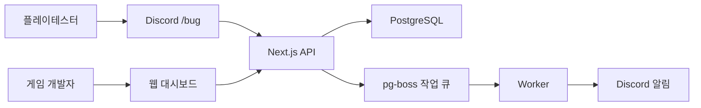

# ReproLoop API 계약

> 문서 상태: MVP 계약 v0.3
> 이 문서의 목적: **Discord, 웹 대시보드, 서버, Worker가 어떤 요청과 응답을 주고받는지** 팀원이 쉽게 이해하도록 설명한다.

## 1. API가 하는 일

ReproLoop에는 두 가지 사용 화면이 있다.

| 사용자 | 사용하는 화면 | API가 하는 일 |
|---|---|---|
| 플레이테스터 | Discord | 버그 제보를 받고 접수 번호를 알려준다. |
| 게임 개발자 | 웹 대시보드 | 제보 목록을 보여주고 상태 변경·중복 병합·수정 처리를 수행한다. |

수정 알림처럼 즉시 처리할 필요가 없는 작업은 Worker가 백그라운드에서 실행한다.



## 2. 기능별 API 한눈에 보기

### Discord에서 사용하는 API

| 기능 | 주소 | 결과 |
|---|---|---|
| Discord 요청 수신 | `POST /api/discord/interactions` | `/bug` 실행, 입력창 표시, 제보 저장 |

### 웹 대시보드에서 사용하는 API

| 기능 | 방식과 주소 | 결과 |
|---|---|---|
| 내 정보 | `GET /api/v1/me` | 로그인 사용자와 소속 조직 조회 |
| 프로젝트 목록 | `GET /api/v1/projects` | 접근 가능한 게임 목록 조회 |
| 프로젝트 상세 | `GET /api/v1/projects/{projectId}` | 프로젝트 설정 조회 |
| 빌드 목록 | `GET /api/v1/projects/{projectId}/builds` | 제보·수정에 사용할 빌드 조회 |
| 빌드 생성 | `POST /api/v1/projects/{projectId}/builds` | 새 게임 버전 등록 |
| 버그 목록 | `GET /api/v1/projects/{projectId}/reports` | 검색·필터가 적용된 제보 목록 조회 |
| 버그 상세 | `GET /api/v1/reports/{reportId}` | 제보 내용과 처리 이력 조회 |
| 버그 기본 정보 수정 | `PATCH /api/v1/reports/{reportId}` | 제목, 심각도 등의 정보 수정 |
| 버그 상태 처리 | `POST /api/v1/reports/{reportId}/transitions` | 조사, 재현, 병합, 수정 완료 처리 |
| 첨부 업로드 시작 | `POST /api/v1/reports/{reportId}/upload-sessions` | 일회용 업로드 링크 발급 |
| 첨부 다운로드 | `POST /api/v1/attachments/{attachmentId}/download-url` | 짧게 유효한 다운로드 링크 발급 |

## 3. 가장 중요한 사용자 흐름

### 3.1 플레이테스터가 버그를 제보한다

```text
1. Discord에서 /bug 실행
2. 문제가 발생한 게임 빌드 선택
3. 입력창에 현상·기대 결과·재현 방법·환경·빈도 작성
4. 서버가 입력을 검사하고 버그 제보 저장
5. Discord에 “BUG-247이 접수되었습니다” 표시
```

Discord의 입력창은 한 번에 최대 5개 항목만 받을 수 있으므로 다음과 같이 나눈다.

직접 입력하는 내용:

| 항목 | 예시 |
|---|---|
| 실제 현상 | 보스 컷신이 끝난 뒤 게임이 멈춤 |
| 기대 결과 | 컷신 종료 후 전투가 시작되어야 함 |
| 재현 방법 | 컷신 마지막 순간에 인벤토리 키 입력 |
| 플랫폼 | Windows 11 |
| 발생 빈도 | 5회 중 3회 |

Discord가 자동으로 제공하거나 앞 단계에서 선택하는 내용:

- 제보자·서버·채널 ID
- 프로젝트와 빌드 ID
- 중복 제출을 막기 위한 Interaction ID

성공 메시지 예시:

```json
{
  "type": 4,
  "data": {
    "flags": 64,
    "content": "BUG-247이 접수되었습니다. 상태가 변경되면 알려드릴게요."
  }
}
```

### 3.2 개발자가 제보를 확인한다

목록 화면은 다음 요청을 사용한다.

```http
GET /api/v1/projects/{projectId}/reports?status=new,reproduced&buildId={buildId}&search=boss&limit=20
```

지원하는 검색 조건:

| 조건 | 설명 |
|---|---|
| `status` | 하나 이상의 처리 상태 |
| `buildId` | 문제가 발생한 빌드 |
| `search` | 제목과 검색 대상 텍스트 |
| `limit` | 한 번에 가져올 개수. 기본 20, 최대 100 |
| `cursor` | 다음 페이지를 가져오기 위한 값 |

목록의 각 항목에는 번호, 제목, 상태, 심각도, 빌드, 제보자 이름, 중복 제보 수와 시각이 들어간다.

상세 화면은 다음 요청을 사용한다.

```http
GET /api/v1/reports/{reportId}
```

상세 응답에는 목록 정보에 더해 실제 현상, 기대 결과, 재현 방법, 실행 환경, 대표 제보, 수정 빌드, 첨부 파일과 상태 이력이 포함된다.

### 3.3 개발자가 버그 상태를 변경한다

모든 상태 변경은 하나의 주소로 보내고 `action` 값으로 행동을 구분한다.

```http
POST /api/v1/reports/{reportId}/transitions
Content-Type: application/json
```

| `action` | 개발자의 행동 | 변경 결과 |
|---|---|---|
| `request_information` | 추가 정보 요청 | `needs_info`로 변경하고 제보자에게 알림 |
| `start_investigation` | 조사 시작 | `investigating`으로 변경 |
| `mark_reproduced` | 재현 성공 | `reproduced`로 변경 |
| `merge_duplicate` | 같은 버그에 병합 | `duplicate`로 변경하고 대표 제보 연결 |
| `mark_fixed` | 수정 완료 | `fixed`로 변경하고 수정 빌드·알림 등록 |
| `unmerge_duplicate` | 잘못된 병합 취소 | 지정한 이전 상태로 복원 |

`expectedVersion`은 두 개발자가 동시에 같은 제보를 수정했을 때 먼저 저장된 변경을 나중 요청이 덮어쓰지 못하게 한다.

추가 정보 요청 예시:

```json
{
  "action": "request_information",
  "message": "문제가 발생한 해상도와 그래픽 설정을 알려주세요.",
  "expectedVersion": 3
}
```

### 3.4 같은 버그 제보를 합친다

```json
{
  "action": "merge_duplicate",
  "canonicalReportId": "대표-제보-uuid",
  "note": "빌드와 오류 현상이 동일함",
  "expectedVersion": 3
}
```

서버는 다음을 확인한다.

- 두 제보가 같은 프로젝트에 속하는가?
- 대표 제보가 자기 자신은 아닌가?
- 대표 제보가 또 다른 중복 제보는 아닌가?
- 서로를 대표로 지정하는 순환 관계가 생기지 않는가?

병합 후에도 각 제보자의 Discord ID는 유지한다. 대표 버그가 수정되면 중복 제보자도 알림 대상이 된다.

### 3.5 수정 완료를 알린다

```json
{
  "action": "mark_fixed",
  "fixedBuildId": "수정-빌드-uuid",
  "note": "Inventory input lock ordering 수정",
  "expectedVersion": 7
}
```

이 요청 하나로 다음 작업이 진행된다.

1. 버그 상태를 `fixed`로 변경한다.
2. 수정된 빌드와 완료 시각을 저장한다.
3. 상태 이력을 남긴다.
4. 대표 제보와 연결된 모든 제보자를 찾는다.
5. 각 제보자에게 보낼 알림을 생성한다.
6. Worker 작업을 큐에 넣는다.

Discord 전송 자체는 Worker가 처리하므로 API 응답이 느려지지 않는다.

## 4. 주요 요청과 응답

### 4.1 현재 로그인 사용자

```http
GET /api/v1/me
```

```json
{
  "data": {
    "id": "사용자-uuid",
    "discordUserId": "123456789012345678",
    "displayName": "dev_kim",
    "organizations": [
      {
        "id": "조직-uuid",
        "name": "Small Moon Studio",
        "role": "owner"
      }
    ]
  }
}
```

### 4.2 빌드 생성

```http
POST /api/v1/projects/{projectId}/builds
Content-Type: application/json

{
  "version": "0.8.15-beta",
  "releasedAt": "2026-08-08T09:00:00.000Z"
}
```

`owner`와 `admin`만 사용할 수 있다.

### 4.3 버그 기본 정보 수정

```http
PATCH /api/v1/reports/{reportId}
Content-Type: application/json

{
  "title": "컷신 직후 인벤토리를 열면 게임 정지",
  "severity": "high",
  "version": 3
}
```

이 API에서는 `title`, `severity`, `location`, `frequency`만 수정한다. 상태, 대표 제보, 수정 빌드는 상태 변경 API로 처리한다.

## 5. 첨부 파일 흐름

Discord 입력창에서는 파일을 직접 받을 수 없으므로, 제보를 저장한 뒤 짧은 시간만 사용할 수 있는 업로드 링크를 제공한다.

```text
제보 저장
→ 일회용 업로드 링크 발급
→ 테스터가 브라우저에서 파일 선택
→ 서버가 크기·실제 형식 검사 및 정제
→ Private Storage에 저장
→ attachments에 파일 정보 저장
```

### 업로드 링크 발급

```http
POST /api/v1/reports/{reportId}/upload-sessions
```

```json
{
  "data": {
    "uploadUrl": "/uploads/일회용-토큰",
    "expiresAt": "2026-08-08T11:00:00.000Z"
  }
}
```

### 파일 업로드

```http
POST /api/v1/uploads/{uploadToken}
Content-Type: multipart/form-data
```

MVP 허용 형식은 `.txt`, `.log`, `.png`, `.jpg`, `.jpeg`, `.webp`다. 텍스트와 로그는 최대 2MB이며, 이미지 제한과 최대 첨부 개수는 팀이 결정한다.

### 개발자 다운로드

```http
POST /api/v1/attachments/{attachmentId}/download-url
```

서버는 프로젝트 멤버인지 확인한 후 짧게 유효한 Signed URL을 반환한다. 이 URL은 DB에 저장하지 않는다.

## 6. 모든 API가 따르는 공통 규칙

### 주소

- 웹 대시보드 API: `/api/v1`
- Discord 요청: `/api/discord/interactions`
- 로그인: `/api/auth/*`

### 데이터 표기

- 요청과 응답의 필드명은 `camelCase`를 사용한다.
- 내부 ID는 UUID 문자열이다.
- Discord ID는 숫자로 변환하지 않고 문자열로 전달한다.
- 시간은 ISO 8601 UTC 문자열이다.

### 공통 enum

공통 enum은 TypeScript `enum`을 따로 만들지 않고, `packages/shared`의 Zod enum 스키마를 단일 원본으로 사용한다. TypeScript 타입은 각 스키마에서 `z.infer`로 생성한다.

| 구분 | Zod 스키마 | 허용 값 |
|---|---|---|
| 조직 역할 | `OrganizationRoleSchema` | `owner`, `admin`, `member` |
| 제보 상태 | `ReportStatusSchema` | `new`, `needs_info`, `investigating`, `reproduced`, `fixed`, `duplicate` |
| 제보 심각도 | `ReportSeveritySchema` | `low`, `medium`, `high`, `critical` |
| 상태 변경 action | `ReportTransitionActionSchema` | `request_information`, `start_investigation`, `mark_reproduced`, `merge_duplicate`, `mark_fixed`, `unmerge_duplicate` |
| 상태 이력 event | `StatusEventTypeSchema` | `report_created`, `information_requested`, `investigation_started`, `report_reproduced`, `duplicate_merged`, `duplicate_unmerged`, `report_fixed` |
| 알림 종류 | `NotificationTypeSchema` | `information_requested`, `report_fixed` |
| 알림 처리 상태 | `NotificationStatusSchema` | `queued`, `processing`, `sent`, `failed` |
| 제품 event | `ProductEventTypeSchema` | `bug_command_started`, `bug_report_submitted`, `report_viewed`, `report_status_changed`, `duplicate_merged`, `fix_notification_sent` |
| Worker job 이름 | `WorkerJobNameSchema` | `notification.send.v1`, `attachment.delete.v1` |
| API 오류 코드 | `ApiErrorCodeSchema` | `VALIDATION_ERROR`, `UNAUTHENTICATED`, `FORBIDDEN`, `NOT_FOUND`, `CONFLICT`, `INVALID_STATUS_TRANSITION`, `FILE_TOO_LARGE`, `UNSUPPORTED_MEDIA_TYPE`, `RATE_LIMITED`, `INTERNAL_ERROR` |

추가 규칙:

- 새 제보의 기본 상태는 `new`다.
- 제보 심각도의 기본값은 `medium`이다.
- `platform`, `frequency`, `defaultLocale`은 MVP에서 자유 문자열이므로 공통 enum에 포함하지 않는다.
- 첨부 MIME 타입은 보안 allowlist 상수로 관리하며 도메인 enum으로 취급하지 않는다.
- Discord Interaction type과 Auth.js 값은 외부 라이브러리가 제공하는 타입을 사용하고 자체 enum을 중복 정의하지 않는다.
- enum 값의 추가·삭제·이름 변경은 API와 DB에 영향을 주는 계약 변경이므로 기능 PR보다 먼저 별도 PR로 병합한다.

### 성공 응답

공통 응답 envelope는 `/api/v1/**` JSON API에만 적용한다. Discord 규격을 따라야 하는 `/api/discord/interactions`와 Auth.js가 관리하는 `/api/auth/**` 응답은 예외다.

단건:

```json
{ "data": {} }
```

목록:

```json
{
  "data": [],
  "meta": { "nextCursor": null }
}
```

#### 단건 성공 응답 필드 규칙

| 경로 | 타입 | 필수 | `null` 허용 | 규칙 |
|---|---|:---:|:---:|---|
| `data` | endpoint별 객체 스키마 | O | X | 리소스가 없으면 `data: null` 대신 `404 NOT_FOUND`를 반환한다. |

단건 성공 응답의 최상위에는 `data`만 허용한다. endpoint가 원시 문자열이나 배열을 반환하지 않고 항상 의미 있는 객체 DTO를 반환한다.

#### 목록 성공 응답 필드 규칙

| 경로 | 타입 | 필수 | `null` 허용 | 규칙 |
|---|---|:---:|:---:|---|
| `data` | endpoint별 객체의 배열 | O | X | 결과가 없으면 `null`이 아니라 빈 배열 `[]`을 반환한다. 배열 원소도 `null`을 허용하지 않는다. |
| `meta` | 객체 | O | X | 목록 응답에는 결과 수와 관계없이 항상 포함한다. |
| `meta.nextCursor` | `string \| null` | O | O | 다음 페이지가 있으면 불투명 문자열, 마지막 페이지면 `null`이다. 빈 문자열은 허용하지 않는다. |

목록 성공 응답의 최상위에는 `data`, `meta`만 허용한다. 클라이언트는 cursor의 내부 형식을 해석하지 않고 다음 요청에 그대로 전달한다.

### 오류 응답

```json
{
  "error": {
    "code": "INVALID_STATUS_TRANSITION",
    "message": "현재 상태에서는 요청한 상태로 변경할 수 없습니다.",
    "requestId": "req_01J...",
    "fieldErrors": {
      "fixedBuildId": ["수정 완료에는 수정 빌드가 필요합니다."]
    }
  }
}
```

#### 오류 응답 필드 규칙

| 경로 | 타입 | 필수 | `null` 허용 | 규칙 |
|---|---|:---:|:---:|---|
| `error` | 객체 | O | X | 오류 응답의 최상위에는 `error`만 허용한다. |
| `error.code` | `ApiErrorCodeSchema` | O | X | 클라이언트 분기와 HTTP 상태 매핑에 사용한다. |
| `error.message` | 비어 있지 않은 `string` | O | X | 사용자에게 표시 가능한 안전한 설명만 포함한다. 내부 예외·SQL·secret은 포함하지 않는다. |
| `error.requestId` | 비어 있지 않은 `string` | O | X | 서버 로그와 요청을 연결하는 식별자다. |
| `error.fieldErrors` | `Record<string, string[]>` | X | X | 필드별 오류가 있을 때만 포함한다. 각 key는 camelCase 필드 경로이고 배열은 한 개 이상의 메시지를 가진다. |

#### optional과 nullable 공통 규칙

| 상황 | 표현 |
|---|---|
| 값이 계약상 항상 존재 | 필수 필드이며 `null` 금지 |
| 값이 현재 없을 수 있지만 필드의 존재 자체가 의미 있음 | 필수 필드와 `null` 사용. 예: `meta.nextCursor` |
| 특정 상황에서만 제공되는 부가 정보 | 필드 생략. 예: `error.fieldErrors` |
| 목록 결과 없음 | `data: []` |
| 단건 리소스 없음 | `404`와 `NOT_FOUND` 오류 응답 |

JSON 응답에는 `undefined`를 사용하지 않는다. Zod object 스키마는 `.strict()`로 선언하여 정의하지 않은 최상위 필드를 거부한다. 성공 응답에는 `error`를, 오류 응답에는 `data`나 `meta`를 함께 넣지 않는다.

| HTTP | 오류 코드 | 사용자가 이해할 의미 |
|---:|---|---|
| 400 | `VALIDATION_ERROR` | 입력값이 잘못됨 |
| 401 | `UNAUTHENTICATED` | 로그인 또는 Discord 요청 검증 실패 |
| 403 | `FORBIDDEN` | 해당 조직·프로젝트에 접근할 권한이 없음 |
| 404 | `NOT_FOUND` | 요청한 대상이 없음 |
| 409 | `CONFLICT` | 중복 요청 또는 다른 사용자의 선행 수정이 있음 |
| 409 | `INVALID_STATUS_TRANSITION` | 현재 상태에서 허용되지 않는 변경 |
| 413 | `FILE_TOO_LARGE` | 파일이 너무 큼 |
| 415 | `UNSUPPORTED_MEDIA_TYPE` | 허용하지 않는 파일 형식 |
| 429 | `RATE_LIMITED` | 짧은 시간에 요청이 너무 많음 |
| 500 | `INTERNAL_ERROR` | 서버 내부 오류 |

## 7. 로그인과 권한

### 개발자 웹 대시보드

- Discord OAuth와 Auth.js로 로그인한다.
- 서버는 모든 요청에서 사용자의 조직 멤버십을 다시 확인한다.
- URL에 있는 프로젝트 ID만으로 접근을 허용하지 않는다.

| 기능 | owner | admin | member |
|---|:---:|:---:|:---:|
| 버그 조회 | O | O | O |
| 정보 요청·조사 시작·재현 완료 | O | O | O |
| 중복 병합·병합 취소·수정 완료 | O | O | X |
| 빌드 생성 | O | O | X |
| Discord 연결·멤버 관리 | O | O | X |
| 조직 삭제 | O | X | X |

MVP 권한 정책은 다음과 같이 확정한다.

- `member`는 `request_information`, `start_investigation`, `mark_reproduced`만 실행할 수 있다.
- `merge_duplicate`, `unmerge_duplicate`, `mark_fixed`는 `owner`와 `admin`만 실행할 수 있다.
- `member`는 빌드를 생성할 수 없다.

### Discord 요청

- Discord가 보내는 `X-Signature-Ed25519`, `X-Signature-Timestamp`를 검증한다.
- 서명 확인은 JSON으로 변환하기 전의 원본 body로 수행한다.
- 검증 실패 시 `401`을 반환한다.
- Discord는 빠른 응답을 요구하므로 3초 안에 응답하거나 deferred response를 사용한다.
- 같은 Interaction ID가 다시 와도 제보는 한 번만 생성한다.

## 8. Worker가 처리하는 작업

Worker는 외부 공개 API를 갖지 않고 PostgreSQL의 pg-boss 큐에서 작업을 가져간다.

| 작업 이름 | 하는 일 | 최대 시도 |
|---|---|---:|
| `notification.send.v1` | Discord 알림 전송 | 5회 |
| `attachment.delete.v1` | 보관 기간이 지난 파일 삭제 | 5회 |

알림 Worker의 처리 순서:

1. 알림이 이미 전송되었는지 확인한다.
2. 처리 중 상태와 시도 횟수를 기록한다.
3. Discord API로 메시지를 보낸다.
4. 성공하면 `sent`, 실패하면 정제된 오류를 저장한다.
5. 실패 시 지수 백오프로 다시 시도한다.

재실행되어도 같은 알림이 두 번 전송되지 않아야 한다.

## 9. 저장 작업의 안전 기준

다음 묶음은 각각 하나의 DB 트랜잭션으로 처리한다.

| 작업 | 반드시 함께 저장할 내용 |
|---|---|
| 버그 생성 | 버그 번호 할당, 제보 저장, 생성 이력, 제품 이벤트 |
| 상태 변경 | 버전 확인, 상태 갱신, 상태 이력, 필요한 알림, Worker 작업 |
| 중복 병합 | 대표 제보 검증, 순환 관계 검사, 상태 변경, 대표 제보 연결, 이력 |

중간에 실패하면 묶음 전체를 취소해 일부 데이터만 남는 일을 막는다.

## 10. 코드에서 공유할 타입

프론트엔드와 백엔드가 서로 다른 요청 형식을 만들지 않도록 `packages/shared`의 Zod 스키마를 함께 사용한다.

```text
packages/shared/src/
├─ reports/       # 목록, 상세, 수정, 상태 변경
├─ discord/       # Discord 입력과 Interaction
├─ attachments/   # 업로드와 다운로드
├─ jobs/          # Worker 작업 payload
└─ api/           # 공통 오류와 페이지네이션
```

우선 만들 스키마:

- `OrganizationRoleSchema`
- `ReportStatusSchema`
- `ReportSeveritySchema`
- `ReportTransitionActionSchema`
- `StatusEventTypeSchema`
- `NotificationTypeSchema`
- `NotificationStatusSchema`
- `ProductEventTypeSchema`
- `WorkerJobNameSchema`
- `ApiErrorCodeSchema`
- `createApiDataResponseSchema`
- `createApiListResponseSchema`
- `ApiPaginationMetaSchema`
- `ApiErrorSchema`

- `DiscordBugModalInputSchema`
- `CreateBugReportCommandSchema`
- `ReportListQuerySchema`
- `UpdateReportSchema`
- `ReportTransitionSchema`
- `CreateUploadSessionSchema`
- `NotificationSendJobV1Schema`
- `AttachmentDeleteJobV1Schema`

## 11. 구현 우선순위

### P0 — 실제 사용 흐름에 꼭 필요

1. Discord PING과 서명 검증
2. `/bug` 실행 → 입력창 → DB 저장
3. Discord 로그인과 프로젝트 권한 확인
4. 버그 목록과 상세 화면 API
5. 조사·재현 등 상태 변경과 이력
6. 중복 제보 병합
7. 수정 빌드 등록과 Discord 알림 Worker

### P1 — P0 동작 후 추가

1. 첨부 파일 업로드와 정제
2. 실패 알림 수동 재시도
3. 제품 이벤트 저장
4. 보관 기간이 지난 파일 삭제

## 12. 최소 테스트 목록

- [ ] Discord PING 요청에 정상 응답한다.
- [ ] 잘못된 Discord 서명을 거부한다.
- [ ] 같은 Interaction ID로 제보가 두 번 생기지 않는다.
- [ ] 조직 외 사용자는 프로젝트 API에 접근할 수 없다.
- [ ] 잘못된 입력값은 일관된 오류 형식으로 응답한다.
- [ ] 허용되지 않은 버그 상태 변경을 거부한다.
- [ ] 오래된 `expectedVersion`을 사용한 수정을 거부한다.
- [ ] 중복 제보의 순환 연결을 거부한다.
- [ ] 수정 완료 시 모든 관련 제보자의 알림이 생성된다.
- [ ] Worker가 재실행되어도 알림을 중복 전송하지 않는다.
- [ ] 정제에 실패한 파일은 Storage에 남지 않는다.

## 13. 팀이 결정해야 할 항목

### 확정된 결정

- [x] 심각도는 `low`, `medium`, `high`, `critical`을 사용하고 기본값은 `medium`으로 한다.
- [x] `member`는 정보 요청·조사 시작·재현 완료만 허용한다.
- [x] MVP에서는 `fixed`를 최종 상태로 사용하고 `closed`를 추가하지 않는다.
- [x] 한 Discord 서버에서 여러 게임 프로젝트를 운영할 수 있다.

### MVP 시작 전에 결정

- [ ] `/bug`에서 빌드를 명령 옵션과 선택 메뉴 중 무엇으로 고를 것인가?
- [ ] 접수 결과를 제보자에게만 보이는 메시지로 고정할 것인가?
- [ ] 이미지 최대 크기와 제보당 최대 첨부 개수는 얼마인가?
- [ ] Discord DM 전송 실패 시 대체 알림을 제공할 것인가?

### 구현하면서 결정해도 되는 항목

- [ ] 업로드 링크를 JWT와 DB 일회용 토큰 중 무엇으로 만들 것인가?
- [ ] API 문서를 OpenAPI로 자동 생성할 것인가?

## 관련 문서

- [ReproLoop 데이터 모델](./ReproLoop_데이터_모델_초안.md)
- [ReproLoop 기술 스택 제안서](./ReproLoop%20기술%20스택%20제안서.md)
- [ReproLoop GitHub 환경 세팅 10단계](./ReproLoop_GitHub_환경세팅_10단계.md)
