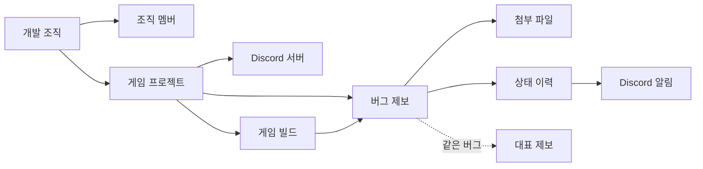
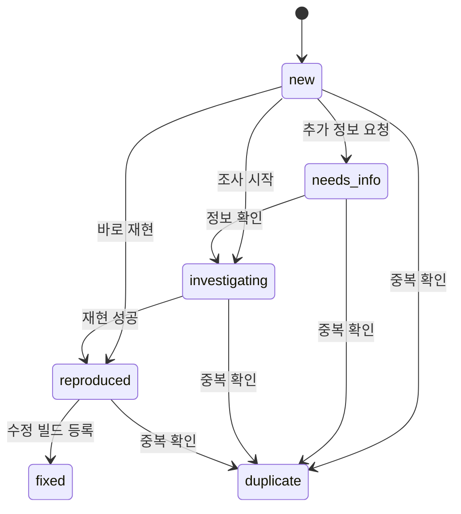

# ReproLoop 데이터 모델

> 문서 상태: MVP 계약 v0.3
> 이 문서의 목적: **ReproLoop가 어떤 정보를 저장하며, 그 정보가 서로 어떻게 연결되는지** 팀원이 쉽게 이해하도록 설명한다.

## 1. ReproLoop를 한 문장으로 설명하면

ReproLoop는 게임 플레이테스터가 Discord에서 버그를 제보하면, 개발팀이 웹 화면에서 제보를 정리하고 처리 결과를 다시 제보자에게 알려주는 서비스다.

```text
플레이테스터가 Discord에서 버그 제보
→ ReproLoop가 제보를 저장
→ 개발자가 조사·재현·수정 상태를 관리
→ 같은 버그는 하나로 합침
→ 수정되면 관련 제보자 모두에게 Discord 알림
```

## 2. 먼저 알아둘 용어

| 용어 | 쉬운 설명 | 예시 |
|---|---|---|
| 조직(Organization) | ReproLoop를 사용하는 개발팀 | `Small Moon Studio` |
| 프로젝트(Project) | 조직이 개발하는 게임 하나 | `Dungeon Delivery` |
| Discord 서버(Guild) | 플레이테스트가 진행되는 Discord 커뮤니티 | `Dungeon Delivery Testers` |
| 빌드(Build) | 플레이테스터에게 배포한 게임 버전 | `0.8.14-beta` |
| 버그 제보(Report) | 플레이테스터가 제출한 문제 한 건 | `BUG-247` |
| 대표 제보(Canonical report) | 같은 버그 제보들을 대표하는 원본 제보 | `BUG-247`이 `BUG-251`, `BUG-260`을 대표 |
| 상태 이력(Status event) | 누가 언제 어떤 처리를 했는지 남긴 기록 | `조사 중 → 재현 완료` |
| 알림(Notification) | 제보자에게 보낼 Discord 메시지와 전송 결과 | `0.8.15에서 수정되었습니다` |

## 3. 데이터 전체 구조

데이터는 세 묶음으로 이해하면 된다.

| 영역 | 저장하는 것 | 관련 테이블 |
|---|---|---|
| 팀과 게임 설정 | 누가 어떤 팀에 속하고, 어떤 게임과 Discord 서버를 관리하는가 | `users`, `organizations`, `organization_members`, `discord_guilds`, `game_projects`, `builds` |
| 버그 처리 | 어떤 버그가 접수되었고, 현재 상태와 처리 이력은 무엇인가 | `bug_reports`, `attachments`, `status_events` |
| 알림과 지표 | 누구에게 알림을 보냈고, 제품이 실제로 사용되는가 | `notifications`, `product_events` |

### 핵심 관계만 본 그림



## 4. 실제 사용 예시

### 예시 A: 새로운 버그가 들어온 경우

1. 테스터 `player01`이 Discord에서 `/bug`를 실행한다.
2. `Dungeon Delivery` 프로젝트와 `0.8.14-beta` 빌드를 선택한다.
3. 현상, 기대 결과, 재현 방법 등을 작성한다.
4. `bug_reports`에 `BUG-247`이 `new` 상태로 저장된다.
5. `status_events`에는 `report_created` 이력이 함께 저장된다.

### 예시 B: 같은 버그가 여러 번 들어온 경우

1. 개발자가 `BUG-251`이 `BUG-247`과 같은 문제임을 확인한다.
2. `BUG-251`의 상태를 `duplicate`로 바꾸고, 대표 제보를 `BUG-247`로 연결한다.
3. 이후 `BUG-247`이 수정되면 `BUG-247`과 `BUG-251`의 제보자 모두에게 알림을 보낸다.

이 구조 덕분에 개발자는 같은 버그를 여러 번 조사하지 않으면서도, 각 제보자와의 연결은 잃지 않는다.

## 5. 팀과 게임 설정 데이터

### 5.1 사용자 — `users`

웹 대시보드에 로그인하는 개발자를 저장한다. 플레이테스터는 로그인하지 않으므로 이 테이블에 들어가지 않는다.

| 저장 정보 | 설명 |
|---|---|
| `id` | ReproLoop 내부 사용자 ID |
| `discord_user_id` | Discord 사용자 ID. 중복될 수 없다. |
| `email` | Discord가 제공한 이메일. 없을 수 있다. |
| `display_name`, `avatar_url` | 화면에 표시할 이름과 프로필 이미지 |
| `created_at`, `updated_at` | 생성·수정 시각 |

### 5.2 조직 — `organizations`

ReproLoop를 사용하는 개발팀이다. 프로젝트와 권한을 묶는 최상위 단위이며, 향후 요금제를 도입하면 결제 단위가 된다.

| 저장 정보 | 설명 |
|---|---|
| `id` | 조직 ID |
| `name` | 팀 이름 |
| `slug` | URL에 사용할 고유 이름 |
| `created_by_user_id` | 조직을 만든 사용자 |
| `created_at`, `updated_at` | 생성·수정 시각 |

### 5.3 조직 멤버 — `organization_members`

어떤 사용자가 어느 조직에 속하며 무엇을 할 수 있는지 저장한다.

| 역할 | 할 수 있는 일 |
|---|---|
| `owner` | 모든 기능, 조직 설정과 멤버 관리 |
| `admin` | 프로젝트·버그 관리, Discord 연결 |
| `member` | 버그 조회, 정보 요청, 조사 시작, 재현 완료 |

주요 필드:

- `organization_id`, `user_id`: 조직과 사용자를 연결한다.
- `role`: `owner`, `admin`, `member` 중 하나다.
- `verified_via_guild_id`, `verified_at`: Discord 서버 관리자 권한을 확인한 경우 기록한다.
- 같은 사용자는 한 조직에 한 번만 가입할 수 있다.

### 5.4 Discord 서버 — `discord_guilds`

ReproLoop 봇이 설치된 Discord 서버 정보를 저장한다.

| 저장 정보 | 설명 |
|---|---|
| `organization_id` | 이 서버를 관리하는 조직 |
| `discord_guild_id` | Discord가 제공하는 서버 ID. 전체에서 고유하다. |
| `name` | 서버 이름 |
| `bug_channel_id` | 기본 버그 제보 채널 |
| `installed_by_user_id`, `installed_at` | 설치한 사용자와 설치 시각 |
| `removed_at` | 봇 연결을 해제한 시각 |

### 5.5 게임 프로젝트 — `game_projects`

조직이 관리하는 게임 한 개를 뜻한다.

| 저장 정보 | 설명 |
|---|---|
| `organization_id` | 소유 조직 |
| `discord_guild_id` | 연결된 Discord 서버 |
| `name`, `slug` | 게임 이름과 조직 내 고유 URL 이름 |
| `default_locale` | 알림 기본 언어. 초기값은 `ko` |
| `archived_at` | 더 이상 운영하지 않는 프로젝트의 보관 시각 |

### 5.6 게임 빌드 — `builds`

테스트에 배포한 버전을 저장한다. 버그가 발생한 버전과 수정된 버전을 모두 이 테이블에서 찾는다.

| 저장 정보 | 설명 |
|---|---|
| `project_id` | 해당 게임 프로젝트 |
| `version` | 사람이 읽는 버전 이름. 예: `0.8.14-beta` |
| `is_active` | Discord 제보 화면에서 선택 가능 여부 |
| `released_at` | 실제 배포 시각 |

같은 프로젝트 안에서는 같은 버전 이름을 두 번 만들 수 없다.

한 Discord 서버에는 여러 게임 프로젝트를 연결할 수 있다. 따라서 Discord 제보 흐름은 서버 ID만으로 프로젝트를 결정하지 않고 프로젝트를 명시적으로 선택해야 한다.

## 6. 버그 처리 데이터

### 6.1 버그 제보 — `bug_reports`

ReproLoop에서 가장 중요한 테이블이다. 제보 내용, 제보자, 발생 빌드, 현재 처리 상태를 한곳에 저장한다.

#### 화면에 보이는 기본 정보

| 저장 정보 | 설명 |
|---|---|
| `report_number` | 프로젝트 안에서 사용하는 번호. 화면에는 `BUG-247`처럼 표시 |
| `title` | 버그 제목 |
| `status` | 현재 처리 상태 |
| `severity` | 버그 심각도. `low`, `medium`, `high`, `critical` 중 하나이며 기본값은 `medium` |
| `build_id` | 문제가 발생한 빌드 |
| `created_at`, `updated_at` | 접수·수정 시각 |

#### 테스터가 입력한 내용

| 저장 정보 | 설명 |
|---|---|
| `actual_result` | 실제로 일어난 현상 |
| `expected_result` | 원래 기대한 결과 |
| `reproduction_steps` | 문제를 다시 발생시키는 순서 |
| `platform` | Windows, Steam Deck 등 실행 환경 |
| `environment` | OS, GPU, 해상도 등 추가 환경 정보 |
| `location` | 게임 내 발생 위치. 없을 수 있다. |
| `frequency` | `항상`, `5회 중 3회` 같은 발생 빈도 |

#### Discord와 연결하는 정보

| 저장 정보 | 설명 |
|---|---|
| `reporter_discord_user_id` | 나중에 알림을 보낼 제보자 ID |
| `reporter_display_name` | 제보 당시 표시 이름 |
| `discord_guild_id`, `source_channel_id` | 제보가 들어온 서버와 채널 |
| `discord_interaction_id` | Discord 재전송으로 같은 제보가 두 번 생기는 것을 방지 |

#### 처리에 사용하는 정보

| 저장 정보 | 설명 |
|---|---|
| `canonical_report_id` | 중복인 경우 연결할 대표 제보 |
| `fixed_build_id` | 버그가 수정된 빌드 |
| `version` | 두 개발자가 동시에 수정할 때 덮어쓰기를 막는 번호 |
| `resolved_at` | 수정 완료 시각 |
| `deleted_at` | 소프트 삭제 시각 |

중요 규칙:

- `duplicate` 상태라면 대표 제보가 반드시 있어야 한다.
- `fixed` 상태라면 수정 빌드가 반드시 있어야 한다.
- 대표 제보는 같은 프로젝트에 있어야 한다.
- 자기 자신이나 이미 중복인 제보를 대표 제보로 선택할 수 없다.

### 6.2 첨부 파일 — `attachments`

스크린샷과 로그 파일 자체는 Private Storage에 두고, 이 테이블에는 파일을 찾고 관리하는 데 필요한 정보만 저장한다.

| 저장 정보 | 설명 |
|---|---|
| `report_id` | 연결된 버그 제보 |
| `storage_path` | Private Storage 내부 경로. 공개 URL이 아니다. |
| `original_filename`, `content_type`, `size_bytes` | 파일 이름·형식·크기 |
| `sha256` | 파일 무결성과 중복 확인용 값 |
| `sanitization_version`, `sanitized_at` | 어떤 규칙으로 언제 정제했는지 |
| `expires_at`, `deleted_at` | 삭제 예정·완료 시각 |

### 6.3 상태 이력 — `status_events`

버그의 현재 상태만 저장하면 과거에 누가 무엇을 했는지 알 수 없다. 이 테이블은 모든 주요 변경을 시간순으로 기록한다.

| 이벤트 | 의미 |
|---|---|
| `report_created` | 제보가 생성됨 |
| `information_requested` | 테스터에게 추가 정보를 요청함 |
| `investigation_started` | 개발자가 조사를 시작함 |
| `report_reproduced` | 버그 재현에 성공함 |
| `duplicate_merged` | 다른 대표 제보에 병합함 |
| `duplicate_unmerged` | 잘못된 대표 제보 병합을 취소함 |
| `report_fixed` | 수정 빌드가 등록됨 |

각 이력에는 대상 제보, 작업한 개발자, 이전·이후 상태, 메모와 발생 시각이 들어간다.

## 7. 알림과 제품 지표

### 7.1 알림 — `notifications`

Discord 메시지를 “보낼 예정인지, 성공했는지, 실패했는지” 관리한다. 웹 요청 중에 바로 메시지를 보내지 않고 Worker가 비동기로 처리한다.

| 저장 정보 | 설명 |
|---|---|
| `report_id`, `status_event_id` | 어떤 변경 때문에 생긴 알림인지 |
| `recipient_discord_user_id` | 받을 사람 |
| `type` | `information_requested` 또는 `report_fixed` |
| `status` | `queued`, `processing`, `sent`, `failed` |
| `idempotency_key` | 재시도해도 같은 메시지가 두 번 가지 않도록 하는 값 |
| `attempt_count`, `last_error_*` | 시도 횟수와 최근 실패 이유 |
| `sent_at` | 전송 성공 시각 |

### 7.2 제품 이벤트 — `product_events`

사용자가 ReproLoop의 핵심 기능을 실제로 쓰는지 확인하기 위한 최소한의 행동 기록이다.

초기에는 다음 이벤트만 기록한다.

- `bug_command_started`: `/bug` 실행
- `bug_report_submitted`: 제보 제출 완료
- `report_viewed`: 개발자가 제보 확인
- `report_status_changed`: 상태 변경
- `duplicate_merged`: 중복 병합
- `fix_notification_sent`: 수정 알림 전송 성공

버그 본문이나 로그 원문은 제품 이벤트에 넣지 않는다.

## 8. 버그 상태가 바뀌는 순서

| 상태 | 의미 | 다음에 가능한 대표 행동 |
|---|---|---|
| `new` | 새 제보 | 정보 요청, 조사 시작, 재현 완료, 중복 처리 |
| `needs_info` | 정보가 더 필요함 | 새 정보 반영, 조사 시작, 중복 처리 |
| `investigating` | 조사 중 | 정보 요청, 재현 완료, 중복 처리 |
| `reproduced` | 재현 성공 | 수정 완료, 중복 처리 |
| `fixed` | 수정 빌드 등록 완료 | MVP에서는 종료 |
| `duplicate` | 대표 제보에 병합됨 | 병합 취소 또는 대표 제보 변경 |



## 9. 개발할 때 반드시 지킬 규칙

### 데이터 형식

- 내부 ID는 UUID를 사용한다.
- Discord ID는 큰 숫자이므로 JavaScript `number`가 아닌 `text`로 저장한다.
- 시간은 모두 PostgreSQL `timestamptz`로 저장한다.
- 첨부 파일의 공개 URL, Discord 토큰, API 키는 DB에 저장하지 않는다.

### 한 번에 처리해야 하는 작업

다음 작업은 중간에 일부만 저장되지 않도록 하나의 DB 트랜잭션으로 처리한다.

- 버그 생성 + 최초 상태 이력 생성
- 상태 변경 + 상태 이력 생성
- 수정 완료 + 관련 제보자 알림 생성
- 중복 병합 + 대표 제보 연결 + 상태 이력 생성

### 권장 인덱스

- 프로젝트별 최신 제보: `project_id`, `status`, `created_at`
- 대표 제보의 중복 목록: `project_id`, `canonical_report_id`
- 제보자별 알림 대상 조회: `reporter_discord_user_id`, `created_at`
- 빌드별 제보 조회: `build_id`

### 삭제와 보관

- 첨부 파일 기본 보관 기간은 30일이다.
- 버그 제보는 즉시 지우지 않고 먼저 `deleted_at`을 기록한다.
- Storage 파일 삭제가 성공한 뒤 `attachments.deleted_at`을 기록한다.

## 10. 구현 순서

1. 공통 enum과 Zod 스키마
2. 사용자·조직·멤버
3. Discord 서버·프로젝트·빌드
4. 버그 제보·상태 이력
5. 상태 전이 규칙과 테스트
6. 중복 병합
7. 알림과 Worker
8. 첨부 파일과 Private Storage
9. 제품 이벤트와 인덱스
10. 첫 Drizzle 마이그레이션

## 11. 팀이 결정해야 할 항목

### 확정된 결정

- [x] 한 Discord 서버에서 여러 게임 프로젝트를 운영할 수 있다.
- [x] `member`는 정보 요청·조사 시작·재현 완료만 수행할 수 있다.
- [x] 중복 병합·병합 취소·수정 완료와 빌드 생성은 `owner`, `admin`만 수행할 수 있다.
- [x] MVP에서는 `fixed`를 최종 상태로 사용하고 `closed`를 추가하지 않는다.
- [x] 심각도는 `low`, `medium`, `high`, `critical`이며 기본값은 `medium`이다.

### MVP 시작 전에 결정

- [ ] 이미지 최대 크기와 제보당 첨부 개수는 얼마인가?

### 구현하면서 결정해도 되는 항목

- [ ] Auth.js 세션을 JWT로 유지할지 DB Adapter를 사용할지
- [ ] 프로젝트별 버그 번호를 DB 함수와 별도 카운터 중 무엇으로 생성할지
- [ ] 실행 환경 정보를 JSONB로 유지할지 일부를 컬럼으로 분리할지
- [ ] Discord DM 실패 시 채널 알림을 대신 보낼지
- [ ] 첨부 파일 보관 기간을 30일로 고정할지 조직별로 설정할지

## 12. MVP 완료 확인

- [ ] 같은 Discord 요청으로 제보가 두 번 생성되지 않는다.
- [ ] 조직 멤버가 아니면 프로젝트 데이터에 접근할 수 없다.
- [ ] 개발자가 프로젝트·상태·빌드별로 제보를 찾을 수 있다.
- [ ] 허용되지 않은 상태 변경은 거부된다.
- [ ] 같은 버그 제보들을 하나의 대표 제보로 묶을 수 있다.
- [ ] 수정 빌드 등록 시 관련 제보자에게 알림이 한 번씩만 간다.
- [ ] 첨부 파일은 정제 후 Private Storage에만 저장된다.

## 관련 문서

- [ReproLoop API 계약](./ReproLoop_API_계약_초안.md)
- [ReproLoop 기술 스택 제안서](./ReproLoop%20기술%20스택%20제안서.md)
- [ReproLoop GitHub 환경 세팅 10단계](./ReproLoop_GitHub_환경세팅_10단계.md)
